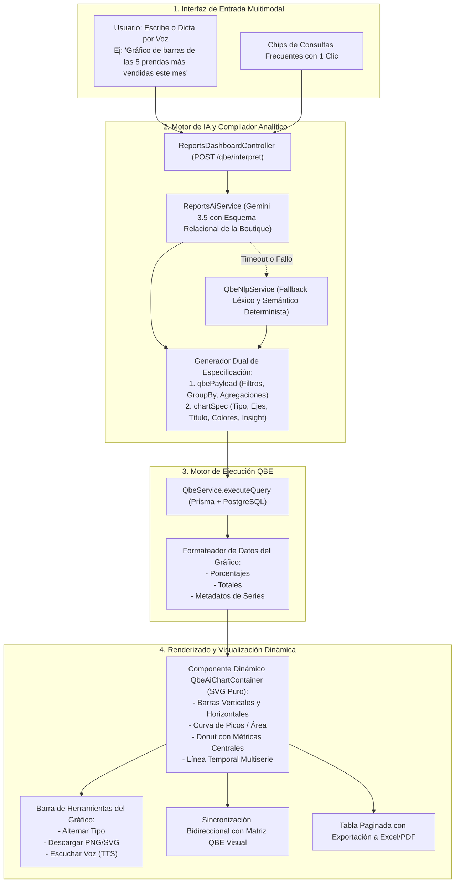

# Plan de Mejora Integral: Reportes QBE Asistidos por IA (Prompt-to-Chart)

Este documento detalla la arquitectura, el diagnóstico y el plan de implementación para elevar el módulo de **Consultas Dinámicas QBE (Query-By-Example)** hacia una experiencia analítica inteligente **Prompt-to-Chart**. La meta fundamental es permitir que el usuario solicite en lenguaje natural (texto o voz) la información deseada y el sistema configure, ejecute y renderice de inmediato el gráfico óptimo, acompañado de métricas clave, explicación ejecutiva y la tabla de datos auditables.

---

## 1. Diagnóstico del Estado Actual de QBE

### Flujo Existente
1. **Entrada de Usuario**:
   - En [`QbeTab.tsx`](file:///home/livi/Documentos/examen2/frontend/src/modules/reports-dashboard/use-cases/CU29-consultar-dashboard-reportes/components/QbeTab.tsx), el usuario dispone de un campo de texto y un botón de micrófono para ingresar consultas en lenguaje natural.
2. **Interpretación en Backend**:
   - La petición viaja al endpoint `POST /api/reports-dashboard/qbe/interpret`.
   - En [`reports-ai.service.ts`](file:///home/livi/Documentos/examen2/backend/src/modules/reports-dashboard/use-cases/CU33-gestionar-reportes-ia/reports-ai.service.ts), se procesa el prompt mediante Gemini si existe clave de API, o mediante el analizador léxico [`qbe-nlp.service.ts`](file:///home/livi/Documentos/examen2/backend/src/modules/reports-dashboard/use-cases/CU32-gestionar-reportes-qbe/qbe-nlp.service.ts).
   - La respuesta devuelve únicamente una sugerencia de payload básico (`entity`, `fields`, `filters`, `groupBy`, `aggregations`, `orderBy`, `limit`, `chartSuggestion`).
3. **Ejecución y Visualización**:
   - El frontend ejecuta `executeQbeQuery(suggestedPayload)` contra [`qbe.service.ts`](file:///home/livi/Documentos/examen2/backend/src/modules/reports-dashboard/use-cases/CU32-gestionar-reportes-qbe/qbe.service.ts).
   - La visualización en el frontend está limitada a:
     - Gráfica de Picos personalizada en SVG (`PeakChartView`).
     - Barras horizontales simples creadas con elementos `div`.
     - Gráfico circular/donut básico con SVG.

### Limitaciones Identificadas
1. **Ausencia de Especificación Completa del Gráfico desde la IA**:
   - La IA actualmente sugiere únicamente un string (`bar`, `pie`, `line`). No define ejes X e Y, título descriptivo del gráfico, métricas a contrastar, formato de moneda (Bs.) o número de series.
2. **Generación Heurística Rígida si no hay GroupBy Explícito**:
   - Cuando la consulta no incluye agrupación explícita, la función `buildAutoChartData` intenta agrupar arbitrariamente sobre la primera columna categórica, produciendo a menudo gráficos poco informativos.
3. **Falta de Variedad y Dinamismo en las Visualizaciones**:
   - No existen gráficos de barras verticales enriquecidas con valores en la cúspide, gráficos de líneas con comparativas temporales de múltiples series ni soporte para comparativas entre sucursales o temporadas.
4. **Falta de Interactividad y Exportación del Gráfico**:
   - El usuario no puede alternar libremente la visualización entre diferentes tipos sin perder la estructura de la consulta, ni descargar el gráfico resultante como imagen PNG o SVG para sus presentaciones.
5. **Carencia de Síntesis Ejecutiva Focalizada en la Gráfica**:
   - La visualización gráfica no muestra una conclusión automática en una frase ("La sucursal Equipetrol concentra el 48% de la facturación..."), lo que obliga al usuario a deducir manualmente las conclusiones.

---

## 2. Arquitectura de la Solución: Prompt-to-Chart



---

## 3. Especificación Técnica de los Componentes

### 3.1. Contrato de Datos Extendido (DTOs y Tipos)

#### Modelo de Especificación de Gráfico (`QbeChartSpec`)
```typescript
export type QbeChartType = 
  | 'bar_vertical'
  | 'bar_horizontal'
  | 'peak_area'
  | 'line_temporal'
  | 'donut_percentage'
  | 'radial_summary';

export interface QbeChartSeriesMeta {
  key: string;
  label: string;
  color?: string;
  unit?: string;
}

export interface QbeChartSpec {
  chartType: QbeChartType;
  title: string;
  subtitle?: string;
  xAxisKey: string;
  xAxisLabel: string;
  yAxisKey: string;
  yAxisLabel: string;
  unit: 'Bs.' | 'unidades' | 'clientes' | 'ordenes';
  series: QbeChartSeriesMeta[];
  aiInsight?: string; // Síntesis ejecutiva de la conclusión del gráfico
}

export interface EnhancedInterpretedQbeResponse {
  interpreted: boolean;
  explanation: string;
  suggestedPayload: ExecuteQbeQueryDto;
  chartSpec: QbeChartSpec;
  detectedKeywords: {
    entityFound: string;
    metricsFound: string[];
    filtersFound: string[];
    groupByFound?: string[];
  };
}
```

---

### 3.2. Prompt de Inferencia Especializado para Gemini

El motor de IA en [`reports-ai.service.ts`](file:///home/livi/Documentos/examen2/backend/src/modules/reports-dashboard/use-cases/CU33-gestionar-reportes-ia/reports-ai.service.ts) se optimizará para deducir tanto la consulta como el diseño gráfico óptimo:

* **Reglas de Selección de Gráfica**:
  1. Si la consulta involucra **evolución temporal** (fechas, días, meses, semanas) -> `line_temporal` o `peak_area`.
  2. Si la consulta busca **comparar categorías, sucursales o rankings de prendas** (Top N) -> `bar_vertical` o `bar_horizontal`.
  3. Si la consulta pide **proporción, distribución o porcentaje** (métodos de pago, tipos de venta, género) con <= 7 partes -> `donut_percentage`.
  4. Si la consulta busca **monitorear stock mínimo vs disponible** -> `bar_horizontal` con umbral.

---

### 3.3. Catálogo de Gráficos SVG Puros en Frontend

Para mantener el sistema libre de dependencias externas pesadas y 100% compatible con React 19 y Vite, implementaremos componentes basados en SVG nativo de alta estética:

1. **Barras Verticales Estilizadas (`VerticalBarChart`)**:
   - Barras redondeadas con gradiente institucional (`#8C5E35` a `#C4956A`).
   - Etiquetas numéricas flotantes en la parte superior de cada barra.
   - Eje X rotulado con nombres de categorías/prendas/sucursales.
   - Tooltip interactivo con valor monetario formateado.
2. **Curva de Picos y Área Sombrada (`PeakAreaChart`)**:
   - Curva Bezier cúbica continua con gradiente suave translúcido.
   - Marcador interactivo en el pico más alto (máximo histórico del período).
   - Líneas de guía horizontal con escala dinámica en bolivianos.
3. **Donut de Precisión con Métrica Central (`DonutChart`)**:
   - Arcos de circunferencia SVG (`strokeDasharray` / `strokeDashoffset`).
   - Centro hueco que despliega la suma total del reporte (ej. "Bs. 124.500").
   - Leyenda lateral con porcentajes calculados, badges de color e interactividad al pasar el cursor.
4. **Líneas Temporales Multiserie (`MultiLineChart`)**:
   - Líneas nítidas para comparar tendencias entre dos o más series (ej. Sucursal Norte vs Sucursal Sur).
   - Nodos de punto con hover y detalle de fecha.

---

## 4. Fases de Implementación

### Fase 1: Extensión de Contratos y DTOs
- **Backend**:
  - Modificar [`qbe.dto.ts`](file:///home/livi/Documentos/examen2/backend/src/modules/reports-dashboard/use-cases/CU32-gestionar-reportes-qbe/qbe.dto.ts) incorporando `QbeChartSpecDto` y enriqueciendo `InterpretedQbeResponse`.
- **Frontend**:
  - Actualizar [`reports.types.ts`](file:///home/livi/Documentos/examen2/frontend/src/modules/reports-dashboard/use-cases/CU29-consultar-dashboard-reportes/types/reports.types.ts) reflejando los nuevos tipos y respuestas.

### Fase 2: Backend - Inferencia Analítica Prompt-to-Chart
- **Optimización de Gemini en `reports-ai.service.ts`**:
  - Adaptar el prompt del sistema para que retorne en una sola inferencia JSON tanto el `suggestedPayload` como la `chartSpec` completa.
- **Robustecimiento del Fallback Local en `qbe-nlp.service.ts`**:
  - Dotar al analizador determinista local de la capacidad de construir una `chartSpec` por defecto inteligente cuando no se use conexión externa.
- **Enriquecimiento en `qbe.service.ts`**:
  - Asegurar que `executeQuery` incluya en `chartData` los campos requeridos por `chartSpec` (porcentajes acumulados, formatos de etiqueta y series).

### Fase 3: Frontend - Módulo de Visualización Dinámica de Gráficos
- **Creación de `DynamicQbeCharts.tsx`**:
  - Implementar los 4 tipos de gráficos SVG puros (`VerticalBarChart`, `PeakAreaChart`, `DonutChart`, `HorizontalBarChart`).
  - Añadir soporte para tooltips reactivos con formato monetario boliviano (`Bs.`).
- **Barra de Controles de Visualización**:
  - Botones para conmutar entre vista de Barras, Picos, Donut y Tabla sin recargar datos.
  - Botón de exportación a imagen PNG (mediante renderizado SVG en elemento Canvas offscreen).
  - Tarjeta de Insight Ejecutiva destacada en la parte superior del gráfico.

### Fase 4: Frontend - Rediseño de la Experiencia en `QbeTab.tsx`
- **Barra de Entrada Prompt Studio**:
  - Rediseñar el encabezado con un campo de búsqueda intuitivo, botón de micrófono con animación de ondas durante la escucha y botón de ejecución rápida.
  - Incorporar una franja de chips con consultas sugeridas de alto impacto:
    * *"Top 5 prendas más vendidas del mes"*
    * *"Ingresos totales por sucursal en gráfica circular"*
    * *"Tendencia de ventas de los últimos 30 días"*
    * *"Prendas con inventario bajo por categoría"*
- **Sincronización Bidireccional con la Matriz QBE**:
  - Al recibir la interpretación de la IA, autoseleccionar la entidad, columnas y condiciones en los desplegables de la interfaz, permitiendo al usuario modificar manualmente cualquier filtro y ver la gráfica actualizarse en tiempo real.

### Fase 5: Validación, Pruebas y Aseguramiento de Calidad
- **Pruebas de Casos Reales**:
  - Validar consultas analíticas con filtros de fecha relativos ("este mes", "última semana", "hoy").
  - Validar consultas comparativas ("por sucursal", "por canal digital vs presencial").
  - Validar consultas de inventario y stock crítico.
- **Verificación de Compilación y Estabilidad**:
  - Ejecutar `npm run build` en backend y frontend para certificar cero errores de TypeScript y estricto apego a las directivas del proyecto (Cero emojis, enlaces válidos).

---

## 5. Matriz de Archivos a Modificar / Crear

| Módulo | Tipo | Ruta | Responsabilidad |
|---|---|---|---|
| Backend | DTO | `backend/src/modules/reports-dashboard/use-cases/CU32-gestionar-reportes-qbe/qbe.dto.ts` | Definición de `QbeChartSpec` e interfaz de respuesta extendida |
| Backend | Service | `backend/src/modules/reports-dashboard/use-cases/CU33-gestionar-reportes-ia/reports-ai.service.ts` | Prompt Prompt-to-Chart para Gemini con generación de visualización |
| Backend | Service | `backend/src/modules/reports-dashboard/use-cases/CU32-gestionar-reportes-qbe/qbe-nlp.service.ts` | Fallback léxico-semántico con asignación de especificación gráfica |
| Backend | Service | `backend/src/modules/reports-dashboard/use-cases/CU32-gestionar-reportes-qbe/qbe.service.ts` | Formateo y enriquecimiento de `chartData` según `chartSpec` |
| Frontend | Types | `frontend/src/modules/reports-dashboard/use-cases/CU29-consultar-dashboard-reportes/types/reports.types.ts` | Tipos TypeScript de especificación y datos de gráficos |
| Frontend | Component | `frontend/src/modules/reports-dashboard/use-cases/CU29-consultar-dashboard-reportes/components/DynamicQbeCharts.tsx` | Componente modular de gráficos interactivos SVG |
| Frontend | Component | `frontend/src/modules/reports-dashboard/use-cases/CU29-consultar-dashboard-reportes/components/QbeTab.tsx` | Integración del Prompt Studio, chips rápidos y contenedor gráfico |

---

## 6. Criterios de Aceptación
1. **Comprensión Directa**: Al ingresar *"mostrar ventas por sucursal en gráfico de torta"*, el sistema debe seleccionar la entidad `venta`, agrupar por `sucursal`, sumar `total`, seleccionar el gráfico `donut_percentage` y dibujarlo inmediatamente.
2. **Cero Dependencias Pesadas**: Gráficos construidos 100% en SVG y React nativo, ligeros, sin librerías externas que incrementen el bundle.
3. **Resiliencia Total**: Si el servicio de IA externo no responde en 5 segundos, el analizador semántico local genera la estructura y el gráfico sin interrumpir la operación del usuario.
4. **Regla Cero Emojis**: Ningún código, vista, log o mensaje contendrá emojis.
