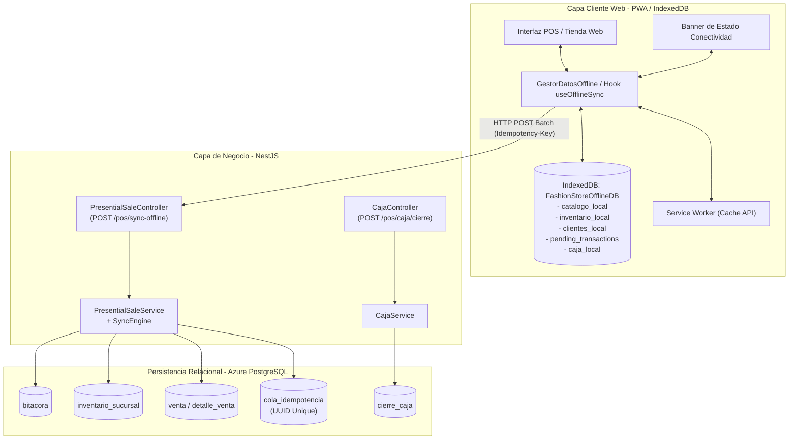
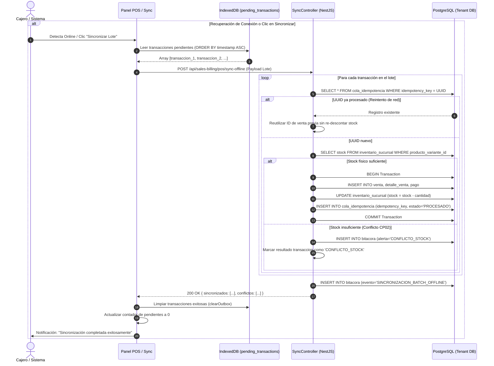

# Plan Maestro de Implementación: Sistema Offline PWA, Sincronización Idempotente y Cierre de Caja

Este documento establece la hoja de ruta técnica y arquitectónica para la implementación integral del soporte fuera de línea (Offline First), sincronización atómica y gestión de cierre de caja en la plataforma web, manteniendo el backend universalmente compatible para clientes móviles.

La especificación se basa estrictamente en el diseño formal documentado en [Doc SI2P2final.docx](file:///home/livi/Documentos/examen2/Doc%20SI2P2final.docx) (Casos de Uso CU16, CU17, CU18; Diagramas de Robustez; Diagramas de Secuencia UML; Pruebas de Calidad CE-03 y Casos CP01 a CP08).

---

## 1. Resumen Ejecutivo y Marco Normativo

### Casos de Uso Involucrados
1. **CU16 - Gestionar Sistema Offline**:
   - Registro de Service Worker para precarga de shell de la aplicación (HTML, CSS, JS, fuentes e iconos).
   - Políticas de almacenamiento en caché (`Cache-First` y `Stale-While-Revalidate`).
   - Detección reactiva de conectividad de red con banner de estado ámbar.
2. **CU17 - Gestionar Datos Offline**:
   - Almacén local en navegador mediante IndexedDB (`FashionStoreOfflineDB`).
   - Pre-descarga de catálogos maestros (productos, variantes, códigos de barra, precios, clientes y existencias de sucursal).
   - Registro de ventas presenciales de contado y solicitudes de reserva sin internet con generación de clave de idempotencia UUIDv4.
   - Descuento preventivo de stock virtual en IndexedDB para impedir sobreventas físicas en mostrador.
   - Emisión de ticket/comprobante temporal con leyenda *"Registrado en Modo Offline — Pendiente de Sincronización"*.
3. **CU18 - Sincronizar Datos Offline a Online**:
   - Detección automática de retorno de conexión (evento `online` / Background Sync) y opción manual *"Sincronizar Ahora"*.
   - Despacho por lotes (Batch Sync) hacia el endpoint `POST /api/sales-billing/pos/sync-offline`.
   - Control de idempotencia con verificación en tabla `cola_idempotencia` (Resolución de falla CE-03).
   - Transacción atómica en PostgreSQL (`prisma.$transaction`) que descuenta inventario central, genera venta oficial y audita en bitácora.
   - Tratamiento de colisiones y conflictos de stock (CP02) sin abortar el resto del lote.
4. **Módulo Administrativo de Cierre de Turno y Caja (Cierre del Día)**:
   - Control de sesiones de caja con apertura (saldo inicial), arqueo intermedio y cierre de turno.
   - Reconciliación entre ventas en efectivo online y transacciones offline pendientes de sincronización.
   - Generación de informe y acta de balance de caja.

---

## 2. Diagramas Arquitectónicos (ICONIX y Secuencia UML)

### Diagrama de Robustez Global

### Diagrama de Secuencia de Sincronización e Idempotencia (CU18)

---

## 3. Desglose de Fases de Implementación

### Fase 1: Capa de Persistencia y Base de Datos (Prisma)
1. **Modelo `cola_idempotencia`**:
   - Registro de transacciones recibidas mediante clave única `idempotency_key` (UUIDv4).
   - Campos: `id`, `idempotency_key`, `tipo_operacion` (`VENTA_POS`, `RESERVA`), `id_sucursal`, `payload_hash`, `respuesta_json`, `estado` (`PROCESADO`, `ERROR`, `CONFLICTO`), `fecha_creacion`.
2. **Modelo `cierre_caja`**:
   - Registro de turnos de punto de venta y cierre diario de caja.
   - Campos: `id`, `id_sucursal`, `id_usuario_cajero`, `fecha_apertura`, `fecha_cierre`, `saldo_inicial`, `total_ventas_efectivo`, `total_ventas_tarjeta`, `total_ventas_offline`, `total_esperado`, `total_real_entregado`, `diferencia`, `estado` (`ABIERTA`, `CERRADA`), `observaciones`, `fecha_creacion`.
3. **Migración en PostgreSQL**:
   - Generación de migración de Prisma y validación en las bases de datos de inquilinos.

### Fase 2: Backend NestJS - Motor Universal de Sincronización y Caja
1. **Submódulo de Sincronización en `sales-billing`**:
   - DTOs: `SyncBatchDto`, `SyncTransactionItemDto`, `SyncResponseDto`.
   - Endpoint `POST /api/sales-billing/pos/sync-offline` en [`presential-sale.controller.ts`](file:///home/livi/Documentos/examen2/backend/src/modules/sales-billing/use-cases/CU27-registrar-venta-presencial/presential-sale.controller.ts).
   - Método `syncBatchSales(user, dto)` en [`presential-sale.service.ts`](file:///home/livi/Documentos/examen2/backend/src/modules/sales-billing/use-cases/CU27-registrar-venta-presencial/presential-sale.service.ts) ejecutado dentro de `prisma.$transaction`.
2. **Manejo de Idempotencia y Reintentos (CE-03 / CP03)**:
   - Detección de claves ya registradas para retornar inmediatamente el comprobante sin duplicar registros contables ni descontar existencias múltiples veces.
3. **Manejo de Conflictos de Stock (CP02)**:
   - Registro en bitácora y emisión de código de estado individual `CONFLICTO_STOCK` sin abortar el resto del lote.
4. **Submódulo de Gestión de Caja (`caja`)**:
   - Endpoints:
     - `GET /api/sales-billing/pos/caja/actual`: Consulta estado de la caja abierta para el cajero.
     - `POST /api/sales-billing/pos/caja/apertura`: Apertura de turno con fondo inicial.
     - `POST /api/sales-billing/pos/caja/cierre`: Cierre de turno, arqueo físico y balance.

### Fase 3: Frontend Web - PWA, Service Worker y Cache-First (CU16)
1. **Configuración de PWA en Vite**:
   - Incorporación de `vite-plugin-pwa` en [`vite.config.ts`](file:///home/livi/Documentos/examen2/frontend/vite.config.ts).
   - Creación de [`manifest.webmanifest`](file:///home/livi/Documentos/examen2/frontend/public/manifest.webmanifest) con nombres, iconos y colores del tema corporativo.
2. **Estrategia de Almacenamiento en Caché**:
   - Precarga (Pre-caching) del App Shell (`index.html`, bundles JS, CSS y fuentes tipográficas).
   - Rutas estáticas con política `Cache-First`.
3. **Detección Reactiva de Conectividad**:
   - Hook personalizado `useOnlineStatus` para escuchar eventos `online` y `offline` de `window`.
   - Componente visual `OfflineBanner` que despliega el aviso ámbar sin interrumpir la experiencia de usuario.

### Fase 4: Frontend Web - Persistencia Local con IndexedDB (CU17)
1. **Base de Datos `FashionStoreOfflineDB`**:
   - Implementación con librería ligera `idb` o API nativa IndexedDB.
   - Stores requeridos:
     - `catalogo_local`: Productos, variantes, precios y tallas.
     - `inventario_local`: Existencias en la sucursal activa.
     - `clientes_local`: Lista de clientes frecuentes de la sucursal.
     - `pending_transactions`: Bandeja de salida (Outbox Queue) con transacciones no sincronizadas.
     - `caja_local`: Estado de turno y arqueo local.
2. **Pre-sincronización en Sesión Conectada**:
   - Al iniciar sesión en el POS, descarga del catálogo y existencias de la sucursal en IndexedDB.
3. **Ejecución de Venta POS Fuera de Línea**:
   - Escaneo y selección de prendas consultando directamente `catalogo_local`.
   - Validación y descuento de stock virtual en `inventario_local`.
   - Creación de la transacción con UUIDv4 (`idempotency_key`) y estado `PENDIENTE_SINCRONIZACION`.
   - Guardado en `pending_transactions`.
4. **Ticket Temporal**:
   - Generación de comprobante digital/imprimible con sello *"Registrado en Modo Offline — Pendiente de Sincronización"*.
   - Badge contador visible en la barra superior con el número de ventas pendientes.

### Fase 5: Frontend Web - Motor de Sincronización Outbox (CU18)
1. **Servicio `offlineSyncService`**:
   - Lectura cronológica de `pending_transactions`.
   - Enlace automático al activarse el evento `online` o Background Sync.
   - Botón interactivo *"Sincronizar Lote Ahora"* en el POS con spinner de progreso.
2. **Procesamiento de Respuesta**:
   - Si la respuesta del backend confirma la transacción, eliminación del registro en `pending_transactions`.
   - Si se reporta conflicto de stock, actualización a estado `CONFLICTO` y despliegue de alerta para intervención del administrador.

### Fase 6: Módulo Administrativo - Cierre del Día y Arqueo de Caja
1. **Pantalla de Cierre de Caja en POS/Admin**:
   - Resumen de ventas del turno clasificadas por: Efectivo, Tarjeta/Stripe y Ventas Offline.
   - Advertencia preventiva si existen transacciones pendientes de sincronización en el navegador antes de cerrar.
   - Formulario de arqueo: ingreso del efectivo contado físicamente, cálculo automático de faltante o sobrante.
   - Envío al endpoint `POST /api/sales-billing/pos/caja/cierre`.

### Fase 7: Validación, Pruebas y Aseguramiento de Calidad
1. **Pruebas Estructurales y Unitarias (Backend)**:
   - Prueba de idempotencia: Envío repetido del mismo UUID sin alteración de balance.
   - Prueba de conflicto de stock: Simulación de quiebre de stock y respuesta no bloqueante.
   - Prueba de cierre de caja con transacciones pendientes.
2. **Pruebas Funcionales E2E (Frontend)**:
   - Desconexión simulada (DevTools Network Offline).
   - Realización de ventas en efectivo en el POS.
   - Verificación de persistencia en IndexedDB y generación de tickets.
   - Reconexión y reconciliación automática con la base de datos central.

---

## 4. Matriz de Componentes y Archivos a Modificar / Crear

| Módulo | Tipo | Ruta del Archivo | Responsabilidad |
|---|---|---|---|
| Backend | Schema | `backend/prisma/schema.prisma` | Modelos `cola_idempotencia` y `cierre_caja` |
| Backend | Migración | `backend/prisma/migrations/...` | DDL de las nuevas tablas |
| Backend | Controller | `backend/src/modules/sales-billing/use-cases/CU27-registrar-venta-presencial/presential-sale.controller.ts` | Endpoint `POST /sales-billing/pos/sync-offline` |
| Backend | Service | `backend/src/modules/sales-billing/use-cases/CU27-registrar-venta-presencial/presential-sale.service.ts` | Lógica de conciliación atómica y resolución de conflictos |
| Backend | Controller | `backend/src/modules/sales-billing/pos/caja.controller.ts` | Endpoints de apertura, estado y cierre de caja |
| Backend | Service | `backend/src/modules/sales-billing/pos/caja.service.ts` | Lógica contable de arqueo y balance de turno |
| Frontend | Config | `frontend/vite.config.ts` | Integración de Service Worker y PWA |
| Frontend | Manifest | `frontend/public/manifest.webmanifest` | Metadatos de instalación PWA |
| Frontend | Storage | `frontend/src/services/offline/offlineStorage.ts` | Capa de persistencia IndexedDB |
| Frontend | Sync | `frontend/src/services/offline/syncEngine.ts` | Motor de despacho Outbox y reconciliación |
| Frontend | Hook | `frontend/src/hooks/useOnlineStatus.ts` | Monitoreo del estado de red |
| Frontend | Component | `frontend/src/components/common/OfflineBanner.tsx` | Banner visual de alerta fuera de línea |
| Frontend | UI POS | `frontend/src/pages/admin/sales/POSView.tsx` | Integración de venta offline, contador y botón sync |
| Frontend | UI Caja | `frontend/src/pages/admin/sales/CajaCierreModal.tsx` | Interfaz de balance y cierre de turno |

---

## 5. Directrices de Calidad y Criterios de Aceptación
1. **Regla Cero Emojis**: Ningún componente, log, commit o mensaje de usuario contendrá emojis.
2. **Aislamiento Multi-Tenant**: Todas las transacciones locales y remotas contendrán obligatoriamente el contexto del tenant autenticado.
3. **Garantía ACID**: Cada lote de sincronización se ejecuta bajo aislamiento de transacción en PostgreSQL.
4. **Independencia de Red**: El punto de venta debe permitir escanear productos, aplicar descuentos locales, cobrar en efectivo y emitir comprobantes sin conexión a internet.
